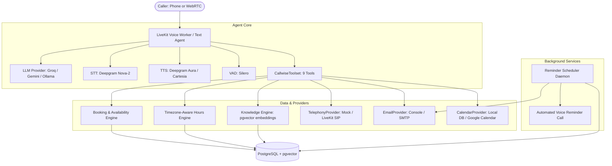

# Callwise 📞🤖

Callwise is a production-ready, multi-tenant voice AI receptionist designed for local service businesses (dental clinics, salons, spas, repair shops, and professional offices).

All tenant data—including knowledge documents, operating hours, service menus, pricing, cancellation policies, transfer routing, and notifications—is driven dynamically from the database with strict tenant isolation.

---

## Architecture Overview



---

## Key Features

### Phase 1: Foundations & Receptionist Core
- **Multi-Tenant from Day One**: Every database table is indexed and foreign-keyed by `business_id`.
- **Dynamic Personas**: Receptionist greetings, tone, and policies are built on-the-fly per tenant.
- **Strict Hallucination Prevention**: If knowledge similarity falls below the cutoff, the agent declines speculation, logs a `knowledge_miss`, and offers to take a message.
- **Interchangeable Providers**:
  - **LLM**: Groq (default: Llama 3.3 70B), Gemini Flash, or local Ollama with exponential backoff on 429 rate limits.
  - **STT**: Deepgram Nova-2.
  - **TTS**: Deepgram Aura or Cartesia.
  - **Embeddings**: Sentence-transformers (`all-MiniLM-L6-v2`) via `pgvector`.
  - **Voice Pipeline**: LiveKit Agents Python framework with WebRTC and text-eval fallback mode.

### Phase 2: Booking, Verification & Live Transfer
- **Service Menus & Pricing**: Configurable bookable services with durations in minutes and custom prices.
- **Timezone-Aware Availability Engine**: Generates 30-minute bookable slots conforming to operating hours, excluding existing appointments, and enforcing minimum notice windows.
- **Double-Booking & Race Condition Prevention**: Uses PostgreSQL tenant row-level locking (`SELECT ... FOR UPDATE`) to eliminate concurrent double-booking vulnerabilities.
- **6-Character Booking Codes**: Generates secure booking codes (e.g., `BK-4X2`) stored as SHA-256 hashes with phone number masking (`***-***-1234`).
- **Caller Verification & Lockout Protection**: Modifying or cancelling appointments requires verification against customer name and phone, with strict 3-attempt lockout per session.
- **Dual-Channel Automated Reminders**:
  - 24 hours prior: Email confirmation and reminder.
  - 2 hours prior: Automated phone reminder call.
  - Background scheduler daemon with `SELECT ... FOR UPDATE SKIP LOCKED` for reliable, zero-duplicate delivery.
- **Live Call Transfer to Human**:
  - Gated by business hours: If closed, offers fallback callback message.
  - Gated by destination phone number configuration.
  - Supports mock and LiveKit SIP trunk providers (`SIPTelephonyProvider`).
  - Automatic email alert dispatch to business owners upon transfer attempts.
- **Google Calendar Synchronization**:
  - Interchangeable `CalendarProvider` interface (`LocalCalendarProvider` and `GoogleCalendarProvider`).
  - Fetches busy blocks via Google Calendar v3 REST API, merges with local reservations, and synchronizes events with graceful fallback.
- **33-Question Benchmark Evaluation Suite**: Automated evaluation across answerable, unanswerable, and prohibited categories with latency tracking and zero-hallucination verification.

---

## Project Structure

```text
callwise/
  docker-compose.yml              (PostgreSQL + pgvector container)
  .env.example                    (Environment configuration template)
  README.md                       (System architecture & user guide)
  pyproject.toml                  (Dependencies and project metadata)
  alembic/                        (Database schema migrations)
  src/callwise/
    config.py                     (Pydantic application settings)
    db/                           (SQLAlchemy models, migrations, and session management)
    providers/                    (LLM, TTS, Embedding, Email, Telephony, Calendar providers)
    knowledge/                    (SSRF-protected loaders, chunker, vector ingest, and search)
    booking/                      (Availability engine, booking service, verification, transfer)
    notifications/                (Email dispatch pipeline and formatted templates)
    reminders/                    (Background reminder scheduler daemon)
    agent/                        (System prompt builder, 9 LiveKit tools, hours, text & voice agents)
    calls/                        (Call turn logging, summaries, and latency tracking)
    cli.py                        (Typer CLI commands)
  tests/                          (Pytest test suite: 102 automated tests)
  evals/                          (Q&A evaluation benchmarks and test datasets)
```

---

## Setup Instructions

### 1. Prerequisites
- **Python 3.11+** installed
- **uv** (recommended) or standard `pip` + `venv`
- **Docker** and **Docker Compose** installed and running

### 2. Configure Environment Variables
Copy `.env.example` to `.env`:

```powershell
# Windows PowerShell
Copy-Item .env.example .env

# macOS / Linux
cp .env.example .env
```

Configure your API keys in `.env`:
- `GROQ_API_KEY`: Groq API key for Llama 3.3 70B
- `DEEPGRAM_API_KEY`: Deepgram API key for STT & TTS
- `LIVEKIT_URL`, `LIVEKIT_API_KEY`, `LIVEKIT_API_SECRET`: LiveKit Cloud project credentials
- `CALENDAR_PROVIDER`: `local` (default, zero-setup PostgreSQL scheduling) or `google` (real Google Calendar)
- For setting up Google Cloud / Google Calendar live sync, see [docs/GOOGLE_CALENDAR_SETUP.md](docs/GOOGLE_CALENDAR_SETUP.md).
- Optional: `GEMINI_API_KEY`, `CARTESIA_API_KEY`, `SMTP_*`, `SIP_TRUNK_URI`

### 3. Start PostgreSQL with pgvector
```bash
docker compose up -d
docker compose ps
```

### 4. Install Dependencies
```bash
uv sync
```

### 5. Run the Test Suite
```bash
uv run pytest -v
```

---

## CLI Command Reference

> [!NOTE]
> On Windows machines with Application Control / AppLocker policies, execute commands via `uv run python -m callwise.cli <command>`.

### Tenant Management & Knowledge Ingestion
```powershell
# Seed demo businesses (Dental Clinic and Hair Salon)
uv run python -m callwise.cli seed

# List registered business tenants
uv run python -m callwise.cli list-businesses

# Ingest knowledge documents
uv run python -m callwise.cli ingest-file --business-id 11111111-1111-1111-1111-111111111111 --file evals/data/dental_knowledge.md --title "Dental Clinic Knowledge Base"

# Check operating hours
uv run python -m callwise.cli check-hours --business-id 11111111-1111-1111-1111-111111111111
```

### Services, Availability & Booking (Phase 2)
```powershell
# 1. List bookable services for a tenant
uv run python -m callwise.cli list-services --business-id 11111111-1111-1111-1111-111111111111

# 2. Add a new bookable service
uv run python -m callwise.cli add-service --business-id 11111111-1111-1111-1111-111111111111 --name "Invisalign Consultation" --duration 30 --price 75

# 3. Book an appointment
uv run python -m callwise.cli book --business-id 11111111-1111-1111-1111-111111111111 --service-id 8b71639d-77bf-4ecd-9909-f32f30382987 --start 2026-11-11T14:00:00 --name "Elenor Vance" --phone "555-0144" --email "elenor@hillhouse.org"

# 4. List booked appointments
uv run python -m callwise.cli list-appointments --business-id 11111111-1111-1111-1111-111111111111

# 5. Reschedule an appointment (requires caller verification)
uv run python -m callwise.cli reschedule-appointment --business-id 11111111-1111-1111-1111-111111111111 --code "BK-4X2" --new-start "2026-11-12T10:00:00" --name "Elenor Vance" --phone "555-0144"

# 6. Cancel an appointment (requires caller verification)
uv run python -m callwise.cli cancel-appointment --business-id 11111111-1111-1111-1111-111111111111 --code "BK-4X2" --name "Elenor Vance" --phone "555-0144"
```

### Live Call Escalation & Reminders (Phase 2)
```powershell
# 1. Test live transfer to human (checks hours & destination number)
uv run python -m callwise.cli transfer --business-id 11111111-1111-1111-1111-111111111111 --reason "Customer has urgent billing dispute"

# 2. View scheduled reminders (24h email + 2h phone call)
uv run python -m callwise.cli list-reminders --business-id 11111111-1111-1111-1111-111111111111

# 3. Run background reminder scheduler daemon
uv run python -m callwise.cli run-scheduler --interval 60

# Or execute a single-pass check
uv run python -m callwise.cli run-scheduler --once
```

### Conversational Testing & Benchmark Evals
```powershell
# Interactive console text chat with AI receptionist
uv run python -m callwise.cli chat --business-id 11111111-1111-1111-1111-111111111111

# Run 33-question benchmark evaluation suite
uv run python -m callwise.cli run-evals

# Start live WebRTC voice agent worker (requires LiveKit Cloud)
uv run python -m callwise.cli run-agent --business-id 11111111-1111-1111-1111-111111111111
```

---

## Telephony Setup & Live SIP Testing (Phase 4)

Callwise can receive inbound telephone calls, resolve the dialed number to the correct tenant business, and route the caller to an interactive voice agent.

### Setup Option A: LiveKit SIP Inbound Trunk
1. In LiveKit Cloud or your self-hosted LiveKit instance, navigate to **SIP** -> **Inbound Trunks**.
2. Create an Inbound Trunk with your LiveKit SIP URI (e.g. `sip.livekit.cloud`).
3. Set your environment variables:
   ```env
   TELEPHONY_PROVIDER=sip
   LIVEKIT_URL=wss://your-livekit-server.livekit.cloud
   LIVEKIT_API_KEY=your_livekit_key
   LIVEKIT_API_SECRET=your_livekit_secret
   SIP_TRUNK_URI=sip:trunk@your-sip-domain.com
   ```
4. Assign your purchased or ported E.164 phone number (e.g. `+15551234567`) to your business via the API or dashboard.

### Setup Option B: Bring-Your-Own SIP Trunk (Twilio Trial)
1. Sign up for a free Twilio trial account and purchase a trial phone number.
2. In the Twilio Console, go to **Voice** -> **SIP Trunking** -> **Create Trunk**.
3. Set the Origination URI to your LiveKit SIP domain: `sip:your-project.sip.livekit.cloud`.
4. Configure Inbound Call routing on your Twilio number to point to this SIP Trunk.

### Setup Option C: Free Softphone Testing (Zero Cost)
You can test the entire SIP telephony and agent routing workflow locally without paying for any carrier or phone number:
1. Download a free SIP softphone client (such as **Linphone** or **Zoiper**).
2. Configure a free SIP account (e.g. through `sip2sip.info` or an internal Asterisk/FreeSWITCH container).
3. In Callwise, assign an E.164 or softphone extension number (e.g. `+15550001`) to your test business via `POST /api/phone-numbers`.
4. Run `uv run python -m callwise.cli run-agent --business-id <UUID>` or initiate mock SIP transfers via `MockTelephonyProvider`.

---

## Known Boundaries & Limitations

In accordance with Phase 2 scope:
1. **Headless / API & CLI First**: Callwise operates via CLI and voice/text streams; an administrative web dashboard is out of scope for Phase 2.
2. **Dual-Channel Reminders**: Reminders use Email (24h prior) and Automated Voice Calls (2h prior). SMS text messaging is not included in Phase 2.
3. **Single Tenant Administrator**: Each business entity has a designated contact phone and notification email; multi-user RBAC and permission hierarchies are not implemented.
4. **Local and Google Calendar Providers**: Supports local database calendar scheduling and Google Calendar v3 REST synchronization. Outlook / Apple Calendar providers are reserved for future phases.
