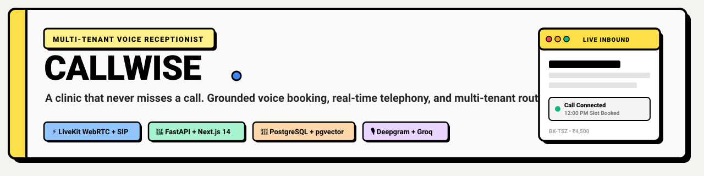
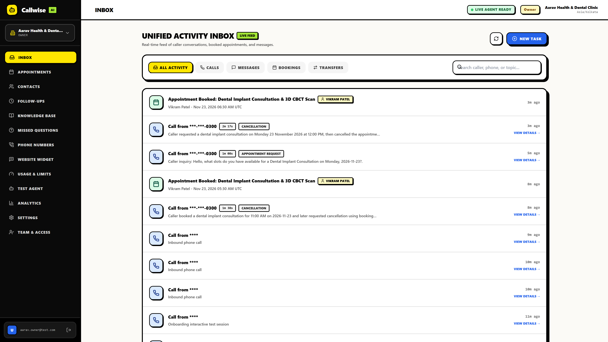
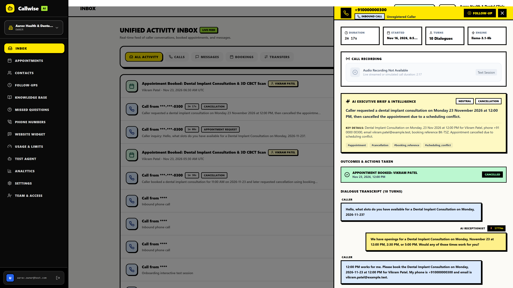
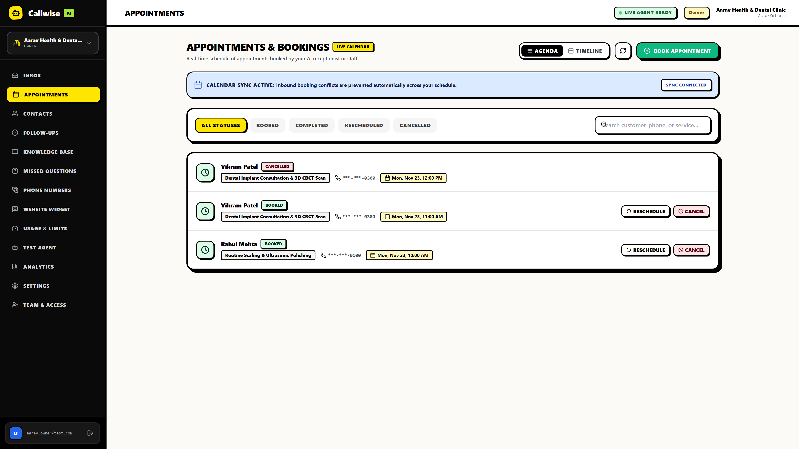
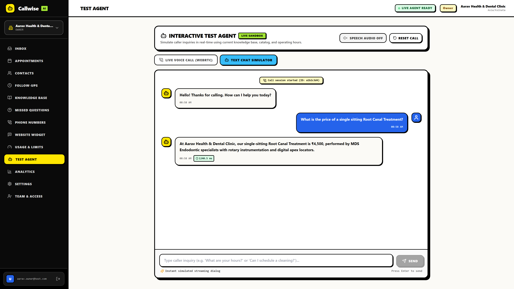
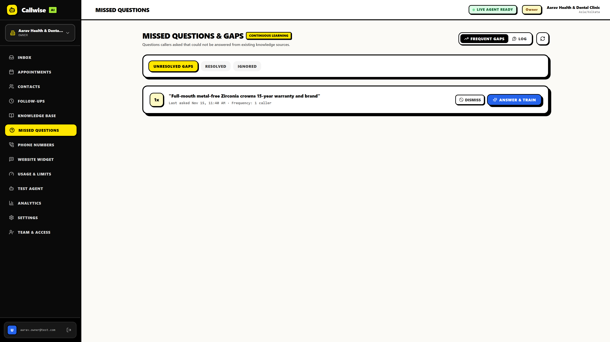
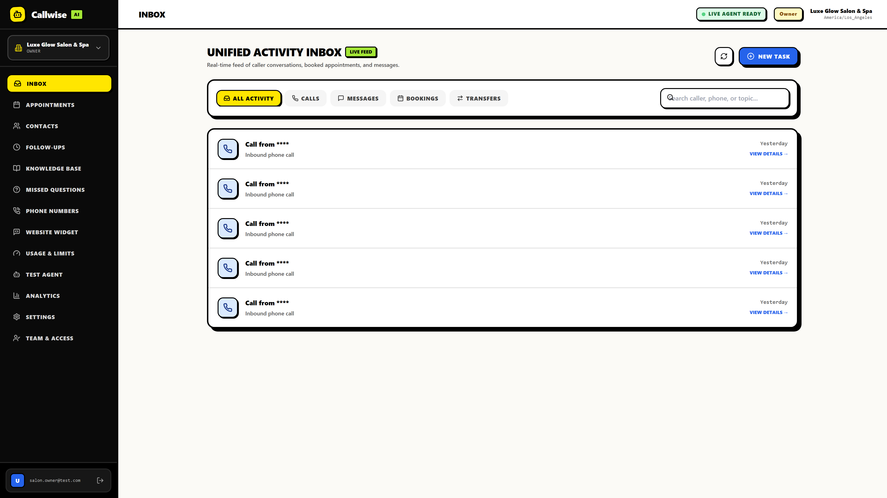
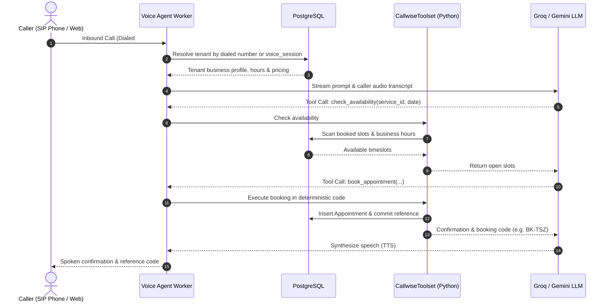
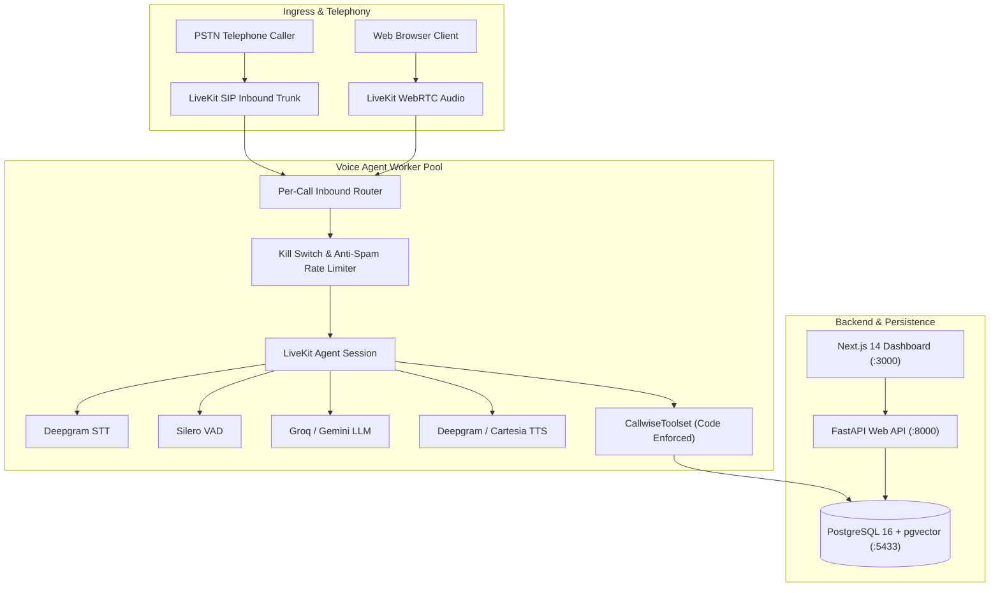

<p align="center">
  
</p>

<h1 align="center">Callwise</h1>

<p align="center">
  <strong>An AI voice receptionist that never misses a call — grounded pricing, live calendar bookings, and multi-tenant telephony.</strong>
</p>

<p align="center">
  <a href="https://fastapi.tiangolo.com/"></a>
  <a href="https://nextjs.org/"></a>
  <a href="https://livekit.io/"></a>
  <a href="https://www.postgresql.org/"></a>
  <a href="LICENSE"></a>
</p>

---

## Demo & Dashboard

<!-- SLOT FOR DEMO RECORDING (I will record it) -->
> [!NOTE]
> **Live Call Walkthrough**: `docs/assets/demo.gif` *(recording placeholder — capture via LiveKit Playground or Dashboard Web Voice)*

| 📥 Real-Time Clinic Inbox | 📋 Transcript, Summary & Notes | 📅 Calendar & Slot Booking |
| :---: | :---: | :---: |
| [](docs/screenshots/02-dashboard-inbox-aarav.png) | [](docs/screenshots/03-call-detail-drawer.png) | [](docs/screenshots/04-appointments-aarav.png) |
| **Aarav Clinic Inbox**<br>Caller ID, tags, urgency triage | **Verified Cancellation Call**<br>Unedited AI summary & transcript | **Real-Time Appointments**<br>Fixed date slot scheduling |
| **🧪 Grounded Price Answers** | **❓ Knowledge Miss Triage** | **🏢 Multi-Tenant Isolation** |
| [](docs/screenshots/09-test-agent-aarav.png) | [](docs/screenshots/08-missed-questions-aarav.png) | [](docs/screenshots/13-inbox-luxe.png) |
| **Text & Voice Simulator**<br>Grounded ₹4,500 root canal price | **Unanswered Queries**<br>Captured for team review & FAQ | **Luxe Glow Salon & Spa**<br>Isolated tenant inbox & data |

---

## The Problem

Local service businesses miss up to 30% of incoming customer calls during peak operating hours, lunch breaks, and evenings. Voicemails rarely convert into customers because callers immediately ring the next business in search results. Existing voice bots either hallucinate unavailable appointment slots or require complex per-business server deployments that make multi-tenant scaling prohibitively expensive.

## What Callwise Does

- 🎙️ **Streaming voice pipeline**: Streams real-time audio via LiveKit WebRTC with Deepgram STT, Groq LLM inference, and Deepgram TTS (see [Quality & Test Results](#quality--test-results)).
- 📅 **Books & cancels appointments**: Code-enforced calendar slots and reference codes (`BK-TSZ`) prevent scheduling collisions.
- 💰 **Speaks grounded facts**: Answers pricing, doctors, and treatments strictly from pgvector document embeddings.
- 🏢 **Routes multi-tenant per call**: A single worker pool resolves tenant identity from the dialed number (`sip.trunkPhoneNumber`).
- 🛑 **Enforces security guards**: Built-in kill switches, caller blocklists, per-tenant usage caps, and anti-spam rejection limits.
- 💬 **Dispatches confirmations**: Instant notifications sent with booking references and clinic instructions.

---

## How a Call Flows



### System Architecture



---

## Try It

### Path A: Fast Local Evaluation (No External API Keys Required, ~5 Mins)

This path runs the PostgreSQL vector database, FastAPI backend, Next.js dashboard, and local text chat simulator with zero cloud API keys:

```powershell
# 1. Start PostgreSQL with pgvector
docker compose up -d postgres

# 2. Apply database migrations
uv run python -m alembic upgrade head

# 3. Seed demo businesses (Aarav Clinic & Luxe Glow Salon)
uv run python -m callwise.cli seed

# 4. Start the FastAPI backend API (port 8000)
uv run python -m uvicorn callwise.api.main:app --port 8000

# 5. Start Next.js dashboard in a separate terminal (port 3000)
npm --prefix web run dev
```

#### Demo Credentials
Open `http://localhost:3000` in your browser:
- **Aarav Health & Dental Clinic (Bengaluru, IST)**: `aarav.owner@test.com` / `Password123!`
- **Luxe Glow Salon & Spa (Los Angeles, PST)**: `salon.owner@test.com` / `Password123!`

Navigate to **Test Agent** (`/test-agent`) to simulate inquiries and bookings directly against the receptionist.

---

### Path B: Full Voice Pipeline (LiveKit + Groq + Deepgram)

To run the voice pipeline worker container with live audio processing:

1. Configure your API keys in `.env`:
   ```bash
   LIVEKIT_URL=wss://your-project.livekit.cloud
   LIVEKIT_API_KEY=your-api-key
   LIVEKIT_API_SECRET=your-api-secret
   DEEPGRAM_API_KEY=your-deepgram-key
   GROQ_API_KEY=your-groq-key
   ALLOW_DEFAULT_BUSINESS=false
   ```

2. Start the containerized voice agent worker:
   ```powershell
   docker compose --profile voice up -d agent
   ```

3. Test live voice interaction:
   - Log into the dashboard at `http://localhost:3000/test-agent` and click **"Start Voice Test"** (WebRTC voice test).
   - Or open your **LiveKit Cloud Dashboard Sandbox** to speak directly to the agent over WebRTC.

---

## Under the Hood: Design Decisions & Trade-Offs

| Decision | Implementation | Trade-Off |
| :--- | :--- | :--- |
| **Multi-Tenant Worker Pool** | Single worker pool dynamically resolves tenant identity per call from dialed E.164 number or token session. | Eliminates per-tenant process overhead; requires dialed numbers to be pre-registered in PostgreSQL. |
| **Code-Enforced Scheduling** | Slot availability, booking collision detection, and cancellation codes execute in plain Python, not the LLM. | Zero hallucinated slots or fake double-bookings; requires tool definitions for scheduling actions. |
| **Abstract Provider Interfaces** | Generic interfaces for LLM (`groq`, `gemini`, `ollama`) and TTS (`deepgram`, `cartesia`). | Allows swapping models via environment variables; limits usage of proprietary model-specific extensions. |
| **Lazy Loading of Audio Stack** | Native voice libraries (`livekit`, `onnx`, `grpc`) load exclusively in the worker container, not the Web API. | Web API boots in under 1 second and runs cross-platform; voice agent requires Linux container. |
| **Strict Test Isolation** | Test runner dynamically enforces isolated `callwise_test` database with autouse teardown fixtures. | Tests run slightly slower (~9s session setup); development database is never polluted with ephemeral rows. |

---

## Security You Can Verify

| Protection | Implementation | Verification Test |
| :--- | :--- | :--- |
| **Tenant Scoping** | Enforced at the API query layer across all models; foreign record IDs rejected with 404/422. | [`tests/test_runtime_tenant_isolation.py`](tests/test_runtime_tenant_isolation.py) |
| **Cross-Tenant Collisions** | Registering an existing number rolls back cleanly with generic 409 and no tenant leak. | [`tests/test_runtime_tenant_isolation.py`](tests/test_runtime_tenant_isolation.py) |
| **Web Voice Session Guard** | Server-signed, single-use `VoiceSession` in DB; client-supplied `business_id` is ignored. | [`tests/test_voice_per_call_routing.py`](tests/test_voice_per_call_routing.py) |
| **SIP Attribute Validation** | `sip.*` attributes are only trusted when `participant.kind == SIP`; fake browser tags are rejected. | [`tests/test_voice_per_call_routing.py`](tests/test_voice_per_call_routing.py) |
| **Anti-Spam Rejection Limit** | Throttles rejection audio per caller (3/hr) and globally (30/min); zero DB rows created on reject. | [`tests/test_voice_per_call_routing.py`](tests/test_voice_per_call_routing.py) |
| **Production Startup Guard** | Worker refuses to start in `production` mode if `ALLOW_DEFAULT_BUSINESS` is enabled. | [`tests/test_voice_per_call_routing.py`](tests/test_voice_per_call_routing.py) |

> [!NOTE]
> **PostgreSQL Row-Level Security Note (FINDING-12)**:
> PostgreSQL RLS policies exist in schema migrations and pass when assuming the non-superuser role in tests (`tests/test_tenant_isolation.py`). However, because the application development connection uses superuser credentials, tenant isolation is currently enforced at the application query layer rather than the database kernel.

---

## Quality & Test Results

All test counts and evaluation figures reflect real execution runs on **November 16–17, 2026**:

- **Backend Unit & Integration Suite**: **240 passed** in `72.96s` (`uv run python -m pytest tests/ -q`).
- **Runtime Tenant Isolation Suite**: **4 passed** in `33.32s` (`uv run python -m pytest tests/test_runtime_tenant_isolation.py`).
- **Voice Routing & Anti-Spoof Suite**: **14 passed** in `9.42s` (`uv run python -m pytest tests/test_voice_per_call_routing.py`).

### Turn Latency Benchmarks (Text Agent Path)

- **Execution Date**: November 16–17, 2026
- **LLM Provider & Exact Model**: Groq (`openai/gpt-oss-20b`)
- **Unthrottled Text-Path Latency (n = 16 turns)**:
  - **Median (p50)**: **1,916.2 ms** (1.92s)
  - **95th Percentile (p95)**: **8,986.3 ms** (8.99s)
  - **Min / Max**: **1,010.0 ms** / **9,506.9 ms**
- **Pipeline Scope**: Measures the **text agent path only** (LLM inference + native function tool dispatch + pgvector knowledge similarity search). **Voice audio pipeline stages (speech-to-text via Deepgram, VAD silence detection, and text-to-speech) are not measured**, as live carrier SIP trunks were not connected.
- *Rate-Limiting Finding*: Under rapid batch execution on Groq's on-demand free tier (30 RPM / 200,000 TPD limits), client-side exponential retry backoff inflated turn turnaround to a median of ~32.0s (p95: ~54.0s). Full telemetry and methodology are documented in [`docs/benchmarks/`](docs/benchmarks/).

### Conversational Evaluations (`uv run python -m callwise.cli run-evals`)

Detailed reports, failed case analysis, and raw JSON logs are documented in [`docs/benchmarks/`](docs/benchmarks/):

| Business | Date | LLM Provider / Exact Model | Cases | Passed | Accuracy | Hallucinations | Advice Refusals |
| :--- | :--- | :--- | :--- | :--- | :--- | :--- | :--- |
| **Aarav Health & Dental Clinic** | 2026-11-16 | Groq (`openai/gpt-oss-20b`) | 17 | 15 | **88.2%** | **0** | 3/4 (75.0%) |
| **Luxe Glow Salon & Spa** | 2026-11-16 | Groq (`openai/gpt-oss-20b`) | 18 | 16 | **88.9%** | **0** | 4/4 (100.0%) |
| **Total / Overall** | 2026-11-16 | Groq (`openai/gpt-oss-20b`) | **35** | **31** | **88.6%** | **0** | **7/8 (87.5%)** |

> **What the Evaluation Failures Taught Me**:
> 1. **Structured Data vs. Vector Search**: A query for dental implant consultation cost failed (`dental-sched-5`) because the price was stored in the structured PostgreSQL `services` table, but the agent relied solely on document embedding retrieval (`search_knowledge`), which retrieved a doctor bio chunk without pricing. Catalog pricing requires structured tool lookup or hybrid ingestion.
> 2. **Timezone-Aware Evaluation**: Testing live transfers to reception staff (`salon-sched-4`) failed static keyword checks when run after-hours (3 AM PST), as the agent accurately checked operating hours and offered callback message taking instead of initiating a dead transfer. Eval rubrics must evaluate state-aware behavior.
> 3. **Clinical Triage vs. Generic Disclaimers**: In acute pain emergencies (`dental-prohib-1`), autonomously escalating the caller to a human dental specialist prevents dangerous self-medication while ensuring the AI does not dispense medical advice. Safety rubrics must account for clinical escalation pathways.

---

<details>
<summary><strong>🔍 Things That Broke and What They Taught Me (Click to Expand)</strong></summary>

### 1. The Test Suite That Left 1,000+ Businesses in Dev
- **What happened**: Early test runs pointed `DATABASE_URL` directly at the local development database, accumulating hundreds of orphaned test fixtures and breaking dashboard pagination.
- **How it was found**: Noticed business counts in the dev database exploding after test execution.
- **The fix**: Created `tests/conftest.py` with an autouse session fixture that forces database URLs to end with `_test`, dropping and rebuilding the test database cleanly on each run.

### 2. Windows Policy Blocking Native LiveKit Extensions
- **What happened**: Workstations with Windows Application Control blocked unsigned `.pyd` native DLLs (`_native.pyd`), crashing the FastAPI server at startup.
- **How it was found**: The web server refused to start on Windows 11 with an OS error 4551.
- **The fix**: Implemented lazy module attributes so `callwise.api` never imports LiveKit or audio DLLs at boot time, and containerized the voice worker under Linux (`Dockerfile.agent`).

### 3. Signup Form Schema Mismatch
- **What happened**: Next.js signup form sent `business_name` and `full_name`, while the backend schema expected `name` and user credentials, producing unhandled validation errors.
- **How it was found**: End-to-end Playwright tests flagged 422 Unprocessable Entity on user registration.
- **The fix**: Aligned Pydantic request models with the frontend payload, unified RBAC role types, and added regression test `web/tests/e2e/signup.test.js`.

### 4. Cross-Tenant Leaks on Body-Supplied IDs
- **What happened**: While route URLs were tenant-scoped, create/update endpoints accepting body foreign IDs (e.g. `service_id`, `contact_id`) failed to verify that the referenced record belonged to the active tenant.
- **How it was found**: The matrix isolation test (`tests/test_runtime_tenant_isolation.py`) simulated Tenant A attacking Tenant B across all endpoints.
- **The fix**: Added explicit tenant ownership validation queries returning generic 404s, preventing cross-tenant appointment links and staff task assignments.

</details>

---

## Limitations

- **PSTN Telephony**: Live telephone answering requires provisioning a SIP trunk (e.g. Twilio or Telnyx) pointed to LiveKit Cloud.
- **Database RLS**: Kernel-level PostgreSQL RLS is not enforced under the default development superuser connection (FINDING-12).
- **Background Reminders**: 2-hour appointment reminder calls log simulated console output unless connected to a live telecom provider.

## Roadmap

1. **Native WhatsApp Interactive Messages**: Send interactive quick-reply buttons for 1-click appointment confirmations and cancellations.
2. **Google Calendar 2-Way Sync**: Bi-directional sync between the clinic's external Google Calendar and Callwise database slots.
3. **Outbound Triage Campaigns**: Automated outbound voice check-ins for high-urgency patient follow-ups.
4. **Custom SIP Dispatch UI**: Web dashboard interface for provisioning and routing new telephone numbers directly from Twilio.

---

## Credits & Inspiration

Callwise is an independent, clean-room implementation inspired by open-source voice receptionist patterns and architectures, including:
- [LiveKit Agents](https://github.com/livekit/agents) — Real-time WebRTC voice pipeline architecture.
- [LobbyStack](https://github.com/lobbystack) & open-source telephony agent designs — Virtual receptionist workflow patterns.

---

## License

This project is licensed under the [MIT License](LICENSE).
